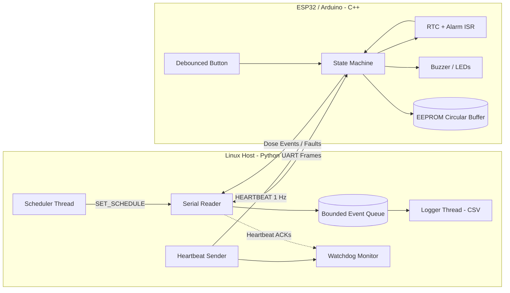

# MediTrack — Smart Pill Reminder (Firmware + Linux Host)

Firmware and host software for a scheduled-dose reminder device. The ESP32/Arduino firmware runs a real-time RTC-driven scheduler, drives buzzer/LED outputs, debounces user buttons, and persists dose events to on-chip EEPROM/flash using a power-cycle-safe circular buffer. A multithreaded Python host on Linux communicates over a CRC-checked serial protocol, sends heartbeats, enforces a watchdog, and logs adherence events to CSV for analysis.

This project was built to practise **software that orchestrates a physical system**: timing, communication, fault handling, concurrency, and system-level testing — not just an isolated application.


---

## Table of Contents

- [Demo](#demo)
- [Overview](#overview)
- [System Architecture](#system-architecture)
- [Hardware](#hardware)
- [Wiring / Pinout](#wiring--pinout)
- [Firmware Design](#firmware-design)
- [Serial Protocol](#serial-protocol)
- [Host Application Design](#host-application-design)
- [Fault Handling & Reliability](#fault-handling--reliability)
- [Testing](#testing)
- [Debugging & Root-Cause Analysis](#debugging--root-cause-analysis)
- [Results / Metrics](#results--metrics)
- [How to Run](#how-to-run)
- [Project Structure](#project-structure)
- [Design Decisions & Tradeoffs](#design-decisions--tradeoffs)
- [Limitations & Future Work](#limitations--future-work)
- [What This Project Demonstrates](#what-this-project-demonstrates)
- [License](#license)

---

## Demo

### 1. Smart Pill Reminder Device


*AI-generated concept illustration of the MediTrack reminder device. This is a design visualization, not a photograph of a verified physical prototype.*

### 2. Hardware Wiring


*Illustrative ESP32, buzzer, LED, display, and button setup.*

### 3. Button Debouncing Visualization


*Illustrative visualization of raw button bounce and a debounced signal.*

### 4. Host Processing Latency


*Illustrative latency chart. Replace it with measurements from actual system tests before reporting performance results.*

### 5. Host Monitoring Dashboard


*Concept visualization of host-side event monitoring and logging.*

### Demo Video

**Watch the MediTrack demonstration:** [Open the demo video](docs/demo.mp4)

The demonstration is intended to illustrate the proposed device workflow. It should not be interpreted as evidence of successful hardware testing unless recorded from the working prototype.

---

## Overview

MediTrack is a two-part system.

1. **Firmware (ESP32 / Arduino, C/C++):** Keeps time, fires dose alerts at scheduled minutes, drives the buzzer and LEDs, reads a dose acknowledgment button, and records events to on-chip EEPROM/flash.
2. **Host (Linux, Python 3):** Sends schedules and heartbeats over serial, receives events, runs a watchdog, and writes event data to CSV for adherence analysis.

### Features

- RTC-interrupt-driven scheduling to reduce timing drift.
- Day-specific dose schedules.
- Buzzer and LED alerts with a dose acknowledgment button.
- Software-debounced button input.
- Power-cycle-safe circular-buffer logging.
- CRC-checked serial protocol with acknowledgment and retries.
- Host-side heartbeat watchdog.
- Multithreaded host application.
- Bounded event queue with backpressure handling and drop accounting.
- Unit testing and fault-injection testing using pytest.

---

## System Architecture



### Data Flow

1. The host sends the dose schedule and heartbeat messages to the firmware.
2. The firmware checks the RTC and activates alerts when a dose is due.
3. The user acknowledges the alert using the button.
4. The firmware records the event and sends it to the host.
5. The host serial reader validates incoming messages.
6. The logger writes received events to CSV.
7. The watchdog monitors heartbeat acknowledgments and detects communication failures.

---

## Hardware

| Component | Part | Purpose |
|---|---|---|
| Microcontroller | ESP32 DevKit / Arduino Uno | Firmware execution and GPIO |
| RTC | DS3231 or supported internal RTC | Timekeeping |
| Buzzer | Active buzzer | Dose alerts |
| LEDs | Red, green, blue | Alert, acknowledgment, fault indication |
| Push button | Tactile button | Dose acknowledgment |
| Resistors | Suitable pull-up and current-limiting resistors | Input stability and LED protection |
| Breadboard | Standard prototyping board | Circuit assembly |
| Jumper wires | Male-to-male / suitable connectors | Component connections |
| USB cable | Compatible cable | Power and serial communication |

**Note:** The final component selection depends on the actual hardware implementation.

---

## Wiring / Pinout

The following is a proposed pin mapping. Confirm compatibility with the selected board and circuit before wiring.

| Signal | MCU Pin | Purpose |
|---|---|---|
| RTC SDA | GPIO21 | I2C data |
| RTC SCL | GPIO22 | I2C clock |
| Buzzer | GPIO25 | Audible alert |
| Red LED | GPIO26 | Dose alert |
| Green LED | GPIO27 | Dose acknowledgment |
| Blue LED | GPIO14 | Fault indication |
| Acknowledgment button | Board-compatible GPIO | User input |
| UART TX | GPIO1 or configured UART TX | Transmit data |
| UART RX | GPIO3 or configured UART RX | Receive data |


**Hardware note:** Verify voltage levels, GPIO restrictions, pull-up configuration, and peripheral connections against the specific board. Some ESP32 pins have input-only or boot-strapping restrictions.

---

## Firmware Design

### State Machine

```mermaid
stateDiagram-v2
    [*] --> BOOT
    BOOT --> SELF_TEST
    SELF_TEST --> IDLE: Peripherals initialized
    SELF_TEST --> FAULT: Initialization failure
    IDLE
