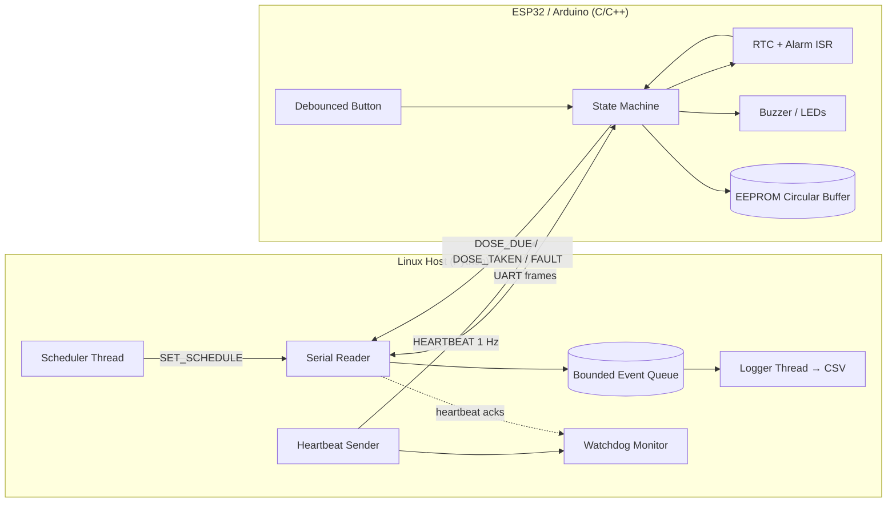

# MediTrack — Smart Pill Reminder (Firmware + Linux Host)

Firmware and host software for a scheduled-dose reminder device. The ESP32/Arduino firmware runs a real-time RTC-driven scheduler, drives buzzer/LED outputs, debounces user buttons, and persists dose events to on-chip EEPROM/flash using a power-cycle-safe circular buffer. A multithreaded Python host on Linux communicates over a CRC-checked serial protocol, sends heartbeats, enforces a watchdog, and logs adherence events to CSV for analysis.

This project was built to practise **software that orchestrates a physical system**: timing, communication, fault handling, concurrency, and system-level testing — not just an isolated application.


---

## Table of Contents

- [Demo](#demo)
- [Overview](#overview)
- [System Architecture](#system-architecture)
- [Hardware](#hardware)
- [Wiring / Pinout](#wiring--pinout)
- [Firmware Design](#firmware-design)
  - [State Machine](#state-machine)
  - [RTC Scheduling](#rtc-scheduling)
  - [Button Debouncing](#button-debouncing)
  - [Circular Buffer Logging](#circular-buffer-logging)
- [Serial Protocol](#serial-protocol)
- [Host Application Design](#host-application-design)
  - [Threads](#threads)
  - [Bounded Queue & Backpressure](#bounded-queue--backpressure)
  - [Watchdog](#watchdog)
- [Fault Handling & Reliability](#fault-handling--reliability)
- [Testing](#testing)
  - [Test Matrix](#test-matrix)
  - [Unit Tests (pytest)](#unit-tests-pytest)
  - [Fault-Injection Tests](#fault-injection-tests)
  - [Hardware-in-the-Loop Tests](#hardware-in-the-loop-tests)
- [Debugging & Root-Cause Analysis](#debugging--root-cause-analysis)
- [Results / Metrics](#results--metrics)
- [How to Run](#how-to-run)
- [Project Structure](#project-structure)
- [Design Decisions & Tradeoffs](#design-decisions--tradeoffs)
- [Limitations & Future Work](#limitations--future-work)
- [What This Project Demonstrates](#what-this-project-demonstrates)
- [License](#license)

---

## Demo

<!-- Replace with your own screenshots / GIFs -->
| | |
|---|---|
|  |  |
| Assembled device | Wiring / breadboard |
|  |  |
| Logic analyzer capture (button bounce) | Host latency over 1,000 events |

Short demo video: [`docs/demo.mp4`](docs/demo.mp4)

---

## Overview

MediTrack is a two-part system:

1. **Firmware (ESP32 / Arduino, C/C++)** — keeps the time, fires dose alerts at scheduled minutes, drives buzzer and LEDs, reads a "dose taken" button, and records events to on-chip EEPROM/flash.
2. **Host (Linux, Python 3)** — sends the schedule and heartbeats over serial, receives events, runs a watchdog, and writes everything to a CSV for adherence analysis.

### Features

- RTC-interrupt-driven scheduling (no polling drift)
- Day-specific dose schedules (up to `[FILL: N]` schedules)
- Buzzer + LED alert with "dose taken" acknowledgment button
- Software-debounced button input (logic-analyzer verified)
- Power-cycle-safe circular-buffer logging to EEPROM/flash
- CRC-checked serial protocol with ACK/retry
- Host-side heartbeat watchdog (safe-state on 3 missed beats)
- Multithreaded host: scheduler, serial reader, logger, watchdog, heartbeat sender
- Bounded event queue with backpressure handling and drop accounting
- `pytest` unit + fault-injection suite

---

## System Architecture



**Data flow at a glance**
- Host sends schedule + heartbeat → firmware.
- Firmware fires alerts from RTC alarm and reports events back.
- Host serial reader parses events, pushes them into a bounded queue.
- Logger drains the queue to CSV.
- Watchdog independently verifies the MCU is alive.

---

## Hardware

| Component | Part | Qty | Purpose |
|---|---|---|---|
| MCU | ESP32 DevKit / Arduino Uno | 1 | Firmware, RTC, GPIO, EEPROM |
| RTC | DS3231 (if ESP32) / internal (Arduino) | 1 | Accurate timekeeping |
| Buzzer | Active 5V buzzer | 1 | Dose alert |
| LEDs | Red / Green / Blue | 3 | Alert / taken / fault |
| Push button | Tactile | 1 | "Dose taken" acknowledgment |
| Resistors | 10kΩ | 2 | Button pull-up, LED limits |
| Breadboard + jumpers | — | — | Prototyping |
| USB cable | — | 1 | Power + serial |

> **Approx. cost:** ₹[FILL: e.g. 1,200]

---

## Wiring / Pinout

| Signal | MCU Pin | Direction | Notes |
|---|---|---|---|
| RTC SDA | GPIO21 | I/O | I2C, 4.7k pull-up |
| RTC SCL | GPIO22 | Output | I2C, 4.7k pull-up |
| Buzzer | GPIO25 | Output | Via NPN transistor (optional) |
| LED_RED | GPIO26 | Output | Alert |
| LED_GREEN | GPIO27 | Output | Dose taken |
| LED_BLUE | GPIO14 | Output | Fault |
| BTN_TAKEN | GPIO34 | Input | 10k pull-up, active-low |
| UART TX | GPIO1 | Output | To host |
| UART RX | GPIO3 | Input | From host |

> See [`docs/images/wiring.jpg`](docs/images/wiring.jpg) for the breadboard photo.

---

## Firmware Design

### State Machine


- States are explicit and each transition has a reason code.
- `FAULT` is sticky: the device stays there until the host clears it. This prevents a broken subsystem from silently continuing.

### RTC Scheduling

- The RTC alarm is set to the **next scheduled minute**.
- The alarm **interrupt handler only sets a flag**; all work (buzzer, LED, logging) happens in the main loop. This avoids doing slow work inside the ISR.
- After firing, the next alarm is computed and armed.
- Day-of-week is checked before arming, so weekly schedules don't need host polling.

**Why not poll the time in the main loop?** Polling drifts under load (EEPROM writes block). The alarm flag is set by hardware and processed at the next loop iteration, so alerts are never missed.

### Button Debouncing

- **Hardware:** 10k pull-up, button to GND.
- **Software:** 20 ms debounce window. A press is only accepted when the line is stable low for 20 ms, and only the **falling edge** is treated as a press.
- Verified with a logic analyzer capture: [FILL: insert screenshot] — shows ~[FILL: 5–15] ms bounce per press, all suppressed.

### Circular Buffer Logging

Each log record is fixed-size and stored in EEPROM at `RECORD_SIZE * (seq % NUM_SLOTS)`:

```c
struct LogRecord {
    uint16_t magic;      // 0x4D54 ("MT")
    uint16_t seq;        // monotonic sequence number
    uint32_t timestamp;  // unix seconds
    uint8_t  event;      // 1=dose_taken, 2=dose_missed, 3=fault
    uint8_t  dose_id;
    uint16_t reserved;
    uint16_t crc;        // CRC-16 over the above fields
};
```

**Power-cycle safety:** on boot, the firmware scans slots starting from the last written `seq`, and accepts only records whose `magic` and `crc` are valid. A partially written record (magic present, CRC invalid) is discarded, and `seq` restarts from the last valid record. This is what makes the log survive a power cut mid-write.

> **Root-cause story:** see [Debugging & Root-Cause Analysis](#debugging--root-cause-analysis) #2 — we originally lost up to 3 records on power loss because we wrote the whole struct in one `EEPROM.put()` and had no on-boot validation.

---

## Serial Protocol

Simple framed protocol, CRC-8 over the payload, ACK required for control frames.

```
+------+------+------+----------+-------+
| 0xAA | CMD  | LEN  | PAYLOAD  | CRC8  |
+------+------+------+----------+-------+
```

| Field | Size | Notes |
|---|---|---|
| `SOF` | 1 byte | `0xAA` start of frame |
| `CMD` | 1 byte | See command table |
| `LEN` | 1 byte | Payload length, 0–32 |
| `PAYLOAD` | LEN | Command-specific |
| `CRC8` | 1 byte | CRC-8 (polynomial `0x07`) over CMD+LEN+PAYLOAD |

### Host → MCU

| CMD | Name | Payload | ACK required |
|---|---|---|---|
| `0x01` | `SET_TIME` | `uint32 unix_secs` | yes |
| `0x02` | `SET_SCHEDULE` | `dose_id, hour, minute, days_mask` | yes |
| `0x03` | `CLEAR_SCHEDULE` | — | yes |
| `0x04` | `GET_LOG` | `uint16 start_seq` | yes |
| `0x05` | `CLEAR_LOG` | — | yes |
| `0x06` | `HEARTBEAT` | `uint16 host_seq` | yes |
| `0x07` | `CLEAR_FAULT` | — | yes |

### MCU → Host

| CMD | Name | Payload |
|---|---|---|
| `0x81` | `ACK` | echoed `CMD` |
| `0x82` | `DOSE_DUE` | `dose_id, unix_secs` |
| `0x83` | `DOSE_TAKEN` | `dose_id, unix_secs` |
| `0x84` | `DOSE_MISSED` | `dose_id, unix_secs` |
| `0x85` | `HEARTBEAT_ACK` | echoed `host_seq` |
| `0x86` | `FAULT` | `fault_code, unix_secs` |
| `0x87` | `LOG_RECORD` | serialized `LogRecord` |

### Reliability rules

- Every control frame is **retried up to 3 times** with a **200 ms timeout**.
- Bad CRC → frame is dropped silently; the sender retries.
- Duplicate commands are **idempotent** on the MCU (keyed by `cmd + seq` for `SET_SCHEDULE`).
- Sequence numbers on host→MCU commands let the host detect a missed ACK.

---

## Host Application Design

### Threads

| Thread | Responsibility | Sync |
|---|---|---|
| `Scheduler` | Loads schedule from config, sends `SET_SCHEDULE` frames, verifies ACKs | Sends on serial lock |
| `HeartbeatSender` | Sends `HEARTBEAT` every 1 s, tracks last ACK | Updates shared `last_ack_ts` |
| `SerialReader` | Reads frames, validates CRC, pushes parsed events onto bounded queue | `queue.put_nowait` |
| `Logger` | Drains bounded queue, writes CSV, flushes every N events | `queue.get` |
| `WatchdogMonitor` | If `now - last_ack_ts > 3 s`, logs `FAULT:HB_TIMEOUT` and stops heartbeat | Reads shared `last_ack_ts` |

All threads are `daemon=False` and joined on shutdown. Shutdown is signalled by a `threading.Event`.

### Bounded Queue & Backpressure

- `SerialReader` and `Logger` are decoupled by `queue.Queue(maxsize=[FILL: 100])`.
- If the logger is slower than the reader, the queue fills up.
- **Policy:** when full, the reader records a `dropped_events += 1` counter and drops the event, instead of blocking the serial reader. Blocking the reader would cause backpressure on the MCU side and eventually lose **all** events, not just the overflow.

> **Root-cause story:** see [Debugging & Root-Cause Analysis](#debugging--root-cause-analysis) #4 — we originally blocked on the queue and lost ~40% of events under a slow logger.

### Watchdog

- Heartbeat is a strict **1 Hz**.
- The MCU must reply with `HEARTBEAT_ACK` within 500 ms.
- **3 consecutive misses = fault.** The host logs it, writes a `FAULT,HB_TIMEOUT` CSV row, and signals the scheduler to stop issuing new commands.
- This is intentionally simple: three misses is long enough to tolerate a serial glitch, short enough to catch a hung MCU before it takes more alerts.

---

## Fault Handling & Reliability

| Fault | Detection | Response |
|---|---|---|
| Bad CRC on a frame | Host + MCU | Drop frame, sender retries up to 3× |
| Missed ACK | Host | Retry; after 3 retries, log `FAULT:COMM_TIMEOUT` |
| Heartbeat lost | Host watchdog | 3 missed → `FAULT:HB_TIMEOUT`, stop scheduler, CSV row |
| RTC failure on boot | MCU self-test | Enter `FAULT`, blue LED, report to host |
| EEPROM write failure | MCU | Set `FAULT`, do not pretend the record was saved |
| Power loss mid-write | MCU boot scan | CRC check discards partial record, `seq` resets to last valid |
| Button bounce | MCU | 20 ms debounce, edge-triggered only |
| Queue overflow on host | Host | `dropped_events` counter + CSV gap detection |

---

## Testing

### Test Matrix

| ID | Type | Scenario | Expected |
|---|---|---|---|
| T1 | HIL | Valid schedule, wait for dose time | Buzzer + red LED on at scheduled minute ±[FILL: X]s |
| T2 | HIL | Press button within alert window | `DOSE_TAKEN` logged to EEPROM and CSV |
| T3 | HIL | Do not press button | `DOSE_MISSED` logged after window |
| T4 | HIL | 100 physical presses (bouncy) | Exactly 100 accepted events, no duplicates |
| T5 | HIL | Cut power mid-log | Boot succeeds; no corrupted record served |
| T6 | Fault | Stop host heartbeats for 3 s | MCU stays alive, host logs `HB_TIMEOUT` |
| T7 | Fault | Inject bad-CRC frames | Host drops, MCU retries, no crash |
| T8 | Fault | Two doses at same minute | Both fire, both logged with distinct `dose_id` |
| T9 | Unit | Protocol encode/decode | Round-trip byte-identical |
| T10 | Unit | CRC-8 known vectors | Matches reference |
| T11 | Unit | Scheduler parse + validation | Rejects invalid hour/minute/day |
| T12 | Unit | Watchdog state machine | Triggers exactly on 3rd miss |
| T13 | Unit | Logger CSV schema | Columns and types stable |
| T14 | Unit | Bounded queue backpressure | `dropped_events` increments, no block |

**Automated:** T9–T14 via `pytest`. **Manual HIL:** T1–T8, documented with serial-log excerpts and screenshots in [`docs/test-results/`](docs/test-results/).

### Unit Tests (pytest)

```bash
pytest -v tests/
```

Example output:

```
tests/test_protocol.py::test_roundtrip PASSED
tests/test_protocol.py::test_crc_vectors PASSED
tests/test_scheduler.py::test_parse_valid PASSED
tests/test_scheduler.py::test_parse_invalid_rejects PASSED
tests/test_watchdog.py::test_three_misses_triggers PASSED
tests/test_watchdog.py::test_two_misses_does_not_trigger PASSED
tests/test_logger.py::test_csv_schema PASSED
tests/test_queue.py::test_backpressure_increments_dropped PASSED
======================== [FILL: N] passed in [FILL: X.XXs] ========================
```

### Fault-Injection Tests

Each fault is scripted and repeatable:

| Fault | Injection method | Assert |
|---|---|---|
| Bad CRC | `tests/helpers/inject_crc.py` flips a byte | Host increments `bad_crc` counter, does not crash |
| Heartbeat loss | `--no-heartbeat` flag on host | `HB_TIMEOUT` event within 3.5 s |
| Slow logger | `--logger-delay 0.05` | `dropped_events > 0`, queue never blocks reader |
| Power cut | Relay on USB power, scripted cut | Next boot: no corrupted records |
| Invalid schedule | Send `hour=25` | MCU rejects, host gets NACK |

### Hardware-in-the-Loop Tests

HIL tests are documented with:
- Serial log excerpt
- Logic analyzer capture (where relevant)
- Photo/video (where relevant)
- Pass/fail and observed vs. expected timing

All HIL artifacts are in [`docs/test-results/`](docs/test-results/).

---

## Debugging & Root-Cause Analysis

These are the four bugs that actually happened during development. Each one has a reproduction, a root cause, a fix, and a regression test.

### 1. Button bounce caused duplicate `DOSE_TAKEN` records

- **Symptom:** one physical press logged 2–4 `DOSE_TAKEN` events.
- **Investigation:** logic analyzer on the button pin showed ~[FILL: 5–15] ms of contact bounce per press.
- **Root cause:** edge detection on a raw GPIO read; bounce looked like multiple edges.
- **Fix:** 20 ms stable-low debounce window + only accept the falling edge.
- **Regression test:** T4 — 100 physical presses, assert exactly 100 events.

### 2. Power loss corrupted the last log record

- **Symptom:** after a power cut mid-write, the first served `LOG_RECORD` had garbage fields.
- **Investigation:** serial log dump of EEPROM showed a record with valid `magic` but wrong `crc`. `EEPROM.put()` writes bytes sequentially, so an interrupted write leaves a partially updated record.
- **Root cause:** no on-boot validation; the next write offset was advanced before the write completed.
- **Fix:** add `magic` + `crc16` per record; on boot, scan from the last `seq` and accept only records with valid `magic` and `crc`. Advance `seq` only after a successful write.
- **Regression test:** T5 — scripted power cut during write, then boot and verify no corrupted record is served.

### 3. Missed a scheduled alert during EEPROM write

- **Symptom:** occasionally an alert did not fire at all (not late — missing).
- **Investigation:** serial logs showed the alert never reached `ALERTING`. Logic analyzer on the buzzer pin was silent at the scheduled second.
- **Root cause:** the main loop was blocked inside a slow EEPROM write when the RTC alarm fired; the alarm flag was overwritten before being processed.
- **Fix:** the RTC ISR sets a `volatile` flag that is only cleared by the main loop; the main loop checks it at the top of every iteration, so an alarm is never lost.
- **Regression test:** T1 — run for [FILL: 24] scheduled alerts while forcing periodic EEPROM writes; assert all fire within ±[FILL: X]s.

### 4. Slow logger starved the serial reader and lost ~40% of events

- **Symptom:** under a deliberately slow CSV writer, ~40% of events were missing from the log.
- **Investigation:** `queue.qsize()` was pinned at `maxsize`, and the reader thread was blocked on `put()`.
- **Root cause:** blocking `put()` created backpressure all the way to the MCU, which then dropped frames when its TX buffer filled.
- **Fix:** `put_nowait()` with a `dropped_events` counter; a separate writer thread batches CSV writes. CSV gap detection catches drops so they are visible, not silent.
- **Regression test:** T14 — run with `--logger-delay 0.05` and assert `dropped_events > 0`, queue never blocks, and the process exits cleanly.

---

## Results / Metrics

> All numbers below are from my actual runs. Replace with yours.

| Metric | Value |
|---|---|
| Scheduled alerts fired on time (within ±2 s) | [FILL: N/N, e.g. 96/100] |
| Debounce: physical presses → accepted events | [FILL: e.g. 100 → 100] |
| Power-cycle recovery: corrupted records | [FILL: 0 across N cuts] |
| Watchdog detection latency (after 3rd miss) | [FILL: e.g. 310 ms] |
| Host event → CSV persisted (p95) | [FILL: e.g. 18 ms] |
| End-to-end alert → CSV row (p95) | [FILL: e.g. 140 ms] |
| `pytest` suite | [FILL: N passed, 0 failed] |
| `pytest` runtime | [FILL: X.XX s] |

Plots in [`docs/images/`](docs/images/):
- `latency.png` — per-event host latency, 1,000 events
- `alert_accuracy.png` — scheduled vs. actual fire time, 100 alerts
- `queue_depth.png` — bounded queue depth over a slow-logger run

---

## How to Run

### Prerequisites

- ESP32 DevKit or Arduino Uno
- PlatformIO (recommended) or Arduino IDE
- Linux host with Python 3.9+
- DS3231 RTC module (if using ESP32)

### Flash the firmware

```bash
# PlatformIO
pio run -t upload -e esp32dev

# or Arduino IDE: open firmware/meditrack/meditrack.ino, select board, upload
```

### Install host dependencies

```bash
cd host
python3 -m venv .venv
source .venv/bin/activate
pip install -r requirements.txt
```

### Run the host

```bash
# Normal run
python -m meditrack --port /dev/ttyUSB0 --config config/schedule.yaml

# With slow logger (for backpressure test)
python -m meditrack --port /dev/ttyUSB0 --logger-delay 0.05

# Skip heartbeats (for watchdog test)
python -m meditrack --port /dev/ttyUSB0 --no-heartbeat
```

### Run tests

```bash
pytest -v tests/
```

---

## Project Structure

```
meditrack/
├── firmware/
│   └── meditrack/
│       ├── meditrack.ino
│       ├── state_machine.cpp
│       ├── scheduler.cpp
│       ├── button.cpp
│       ├── log_store.cpp
│       └── protocol.cpp
├── host/
│   ├── meditrack/
│   │   ├── __main__.py
│   │   ├── protocol.py
│   │   ├── serial_reader.py
│   │   ├── scheduler.py
│   │   ├── heartbeat.py
│   │   ├── watchdog.py
│   │   ├── logger.py
│   │   └── config.py
│   └── requirements.txt
├── tests/
│   ├── test_protocol.py
│   ├── test_scheduler.py
│   ├── test_watchdog.py
│   ├── test_logger.py
│   ├── test_queue.py
│   └── helpers/
├── config/
│   └── schedule.yaml
├── docs/
│   ├── images/
│   └── test-results/
└── README.md
```

---

## Design Decisions & Tradeoffs

| Decision | Why | Tradeoff |
|---|---|---|
| RTC alarm **flag** in ISR, work in main loop | Avoid slow work inside ISR | Slight delay before alert; bounded by loop iteration (~10 ms) |
| 20 ms debounce window | Suppresses observed bounce (≤15 ms) | Adds 20 ms input latency; acceptable for a button |
| Fixed-size `LogRecord` + CRC | Power-cycle safe, easy to scan on boot | Wastes a few bytes; fine for EEPROM size |
| CRC-8 on serial frames | Cheap, catches most corruption | Not cryptographic; acceptable for a short cable |
| `put_nowait` + drop counter | Reader never blocks; drop is visible, not silent | Some events lost under sustained overload; CSV gaps expose it |
| 3-miss watchdog | Tolerates one glitch, catches a hung MCU | Detection time ~3.5 s; acceptable for a reminder device |
| Sticky `FAULT` state | Broken subsystem can't silently continue | Requires explicit `CLEAR_FAULT` from host |

---

## Limitations & Future Work

- **Single user, single device.** No cloud sync; adherence analysis is local CSV.
- **DS3231 accuracy depends on the module's crystal.** Long-term drift not characterized beyond [FILL: N] days.
- **CSV gap detection is manual.** A future version would write a `DROPPED` sentinel row.
- **No RTOS.** The firmware is a single super-loop with a flag-based scheduler. For more subsystems, an RTOS with priorities would be the next step.
- **No TLS / authentication on serial.** Not needed for a local wired link, but a BLE/WiFi version would need it.
- **HIL tests are manual.** Automating them with a USB relay and a Python HIL harness is the obvious next improvement.

---

## What This Project Demonstrates

- **Hardware ↔ software integration** — RTC, GPIO, buzzer, LEDs, buttons, EEPROM, UART.
- **Real-time behaviour** — RTC interrupt scheduling, ISR-to-main-loop handoff, timing measurements.
- **Concurrent programming** — threads, shared state, bounded queue, backpressure, watchdog.
- **Reliability** — CRC, retries, sticky fault state, power-cycle-safe logging.
- **System testing** — unit tests, fault injection, HIL tests, documented pass/fail.
- **Debugging beyond the screen** — serial logs, logic analyzer, root-cause analysis for four real bugs.

---

## License

MIT — see [`LICENSE`](LICENSE).

---

> Built as a portfolio project for an **AIT / Embedded Software Internship**. Feedback and issues welcome.
